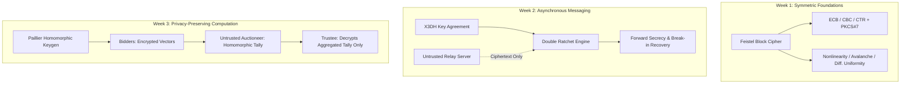

# Overall Security Architecture & Threat Model

## Threat Modeling Principles

Across all three systems, we adhere to the **Principle of Least Privilege**, **Kerckhoffs's Principle** (the security of the system depends on the secrecy of the keys, not the obscurity of the algorithm), and explicit protocol threat boundaries.

## Security Summary & Assumptions

1. **Week 1 (Feistel Cipher)**:
   - *Intended role*: Educational study of diffusion, confusion, and block cipher construction.
   - *Cryptanalysis*: Non-hardened custom S-boxes and round functions; not resistant to high-order differential/linear cryptanalysis.
   - *Timing*: Python integers and lookup tables have variable-time execution and cache-timing side channels.

2. **Week 2 (Double Ratchet Collaboration)**:
   - *Intended role*: Production-grade protocol design using vetted cryptographic primitives (`cryptography.hazmat` X25519, Ed25519, HKDF-SHA256, ChaCha20-Poly1305 / AES-256-GCM).
   - *Untrusted Server*: The relay server cannot access message payloads; header encryption prevents metadata correlation of ratchet steps where enabled.
   - *Compromise boundaries*: Loss of ephemeral state yields immediate forward secrecy for past messages and post-compromise recovery after the next DH ratchet step.

3. **Week 3 (Paillier Sealed-Bid Auction)**:
   - *Intended role*: Privacy-preserving multi-party computation.
   - *Cryptographic guarantee*: IND-CPA security under the Decisional Composite Residuosity Assumption (DCRA).
   - *Threat boundary*: Auctioneer only operates over ciphertexts using additive homomorphic multiplication $\prod c_i \pmod{n^2}$. The Trustee decrypts only aggregate price-level counters, never revealing individual losing or winning bids.
