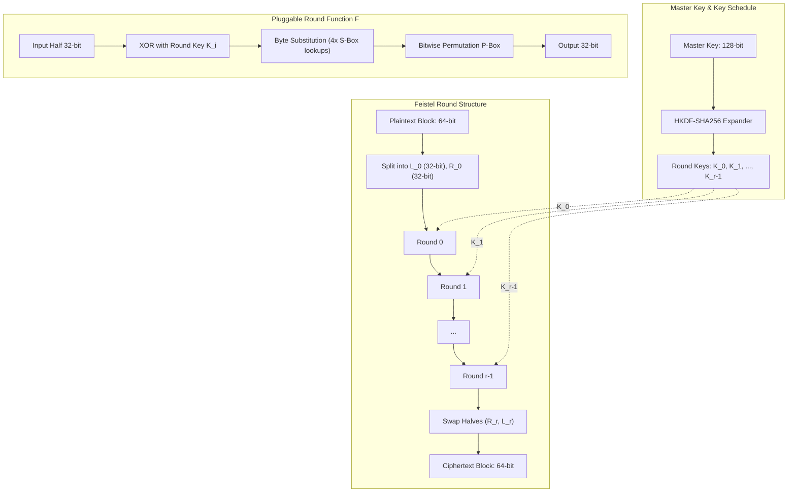

# Week 1: Feistel Architecture & System Design

## Architecture Overview

The system is architected as an extensible block cipher framework separating:
1. **Generic Feistel Round Structure**
2. **Pluggable Round Functions & S-Boxes**
3. **Deterministic Key Schedule**
4. **Cipher Modes of Operation (ECB, CBC, CTR) with PKCS#7 Padding**
5. **Cryptanalytic & Evaluation Utilities**

## Modular Components

### 1. Pluggable S-Boxes (`substitution.py`)
- **Fixed S-box**: Derived from Rijndael $\mathbb{F}_{2^8}$ inversion with affine transformation.
- **Key-Dependent S-box**: Dynamically constructed per master key via Fisher-Yates shuffle seeded with SHA-256 HKDF output.
- **Custom Hybrid S-box**: Non-linear polynomial map $x \mapsto x^7 + 0x63 \pmod{256}$ with fixed-point elimination.

### 2. P-Boxes (`permutation.py`)
- 32-bit diffusion permutation that diffuses each output bit of an S-box into different S-boxes in the subsequent round.

### 3. Key Schedule (`key_schedule.py`)
- Uses HKDF (RFC 5869) with SHA-256 to extract and expand 128-bit master keys into $r$ independent 32-bit round subkeys.

### 4. Modes of Operation (`modes.py`)
- **ECB**: Electronic Codebook (independent block encryption).
- **CBC**: Cipher Block Chaining ($C_i = E_K(P_i \oplus C_{i-1})$) using cryptographic IVs (`secrets.token_bytes`).
- **CTR**: Counter mode ($C_i = P_i \oplus E_K(Nonce \parallel Counter)$), parallelizable and streaming.
