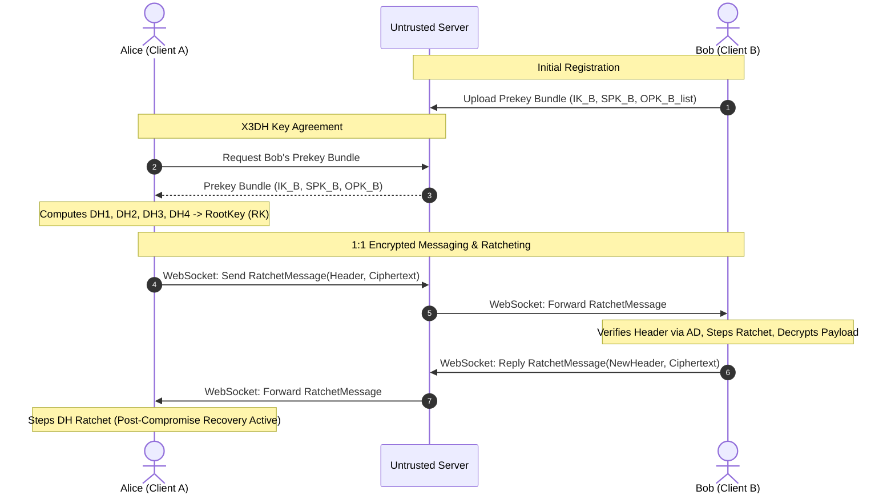
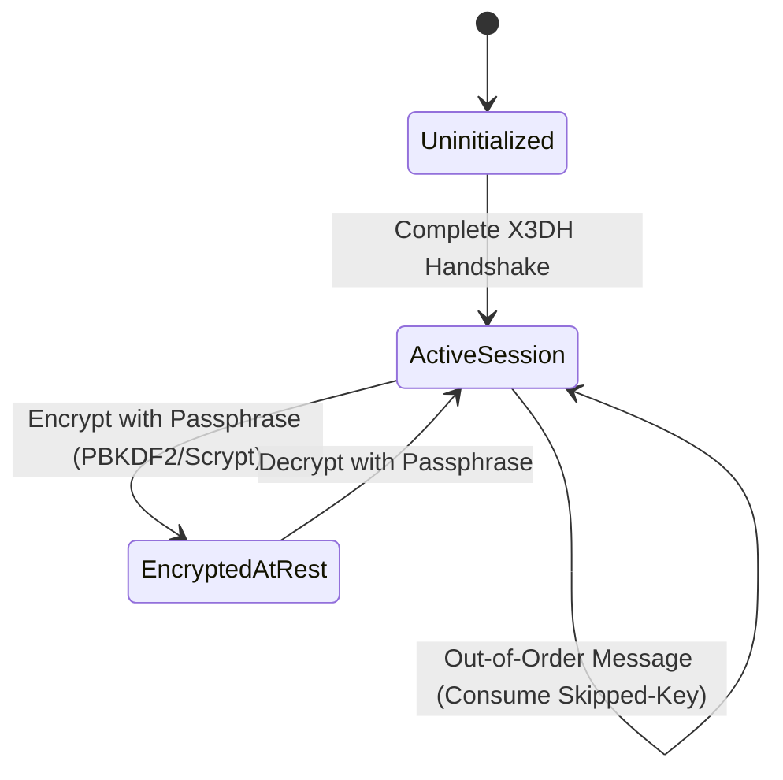

# Week 2: E2E Encrypted Collaboration Architecture

## System Architecture

The collaboration tool is partitioned into three decoupled tiers:
1. **Cryptographic Core (`week2_double_ratchet/crypto/`)**: A pure, synchronous state machine with zero networking or storage dependencies.
2. **Untrusted WebSocket Relay (`week2_double_ratchet/backend/`)**: FastAPI server acting as a dumb mailbox / message switchboard.
3. **Client Engine & Local UI (`week2_double_ratchet/client/`)**: Python daemon that orchestrates crypto, websocket networking, and serves a local web UI.

## State Machine Layout

## Collaboration Features
1. **1:1 Encrypted Chat**: Real-time bidirectional messaging over WebSocket.
2. **Encrypted Collaborative Notes**: Document updates (JSON patches/CRDT-like deltas) transmitted as encrypted ratchet messages over pairwise sessions.
3. **Interactive Ratchet Inspector**: Visualizes Root Key fingerprints, sending/receiving counters, and DH key turns in the local web UI.
