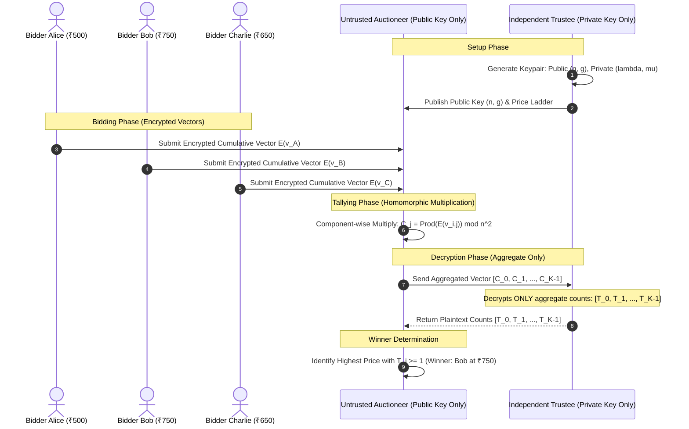

# Week 3: Sealed-Bid Auction Architecture

## Multi-Party Architecture

In an auction, computing the winning bid requires comparisons ($b_1 > b_2$). However, **Paillier cannot compare ciphertexts directly** without decrypting them.

To preserve complete bid secrecy without decrypting individual bids, we partition the system into three distinct cryptographic roles:
1. **Bidders**: Each bidder selects a bid from a discrete price ladder $P = [p_0, p_1, \dots, p_{K-1}]$ and submits an **encrypted cumulative indicator vector**:
   $$\mathbf{v} = [E(v_0), E(v_1), \dots, E(v_{K-1})]$$
   where $v_j = 1$ if $\text{bid} \ge p_j$, and $0$ otherwise.
2. **Untrusted Auctioneer**: Holds the **Public Key only**. Collects all bidder vectors and computes the component-wise homomorphic sum:
   $$C_j = \prod_{i=1}^N E(v_{i, j}) \pmod{n^2}$$
   $C_j$ is the encryption of the total count of bidders willing to pay price $p_j$ or higher.
3. **Independent Trustee**: Holds the **Private Key**. Decrypts **ONLY the aggregated vector** $\mathbf{C}$:
   $$\mathbf{T} = [D(C_0), D(C_1), \dots, D(C_{K-1})]$$
   The Trustee never sees individual vectors and never has access to the auction database.

