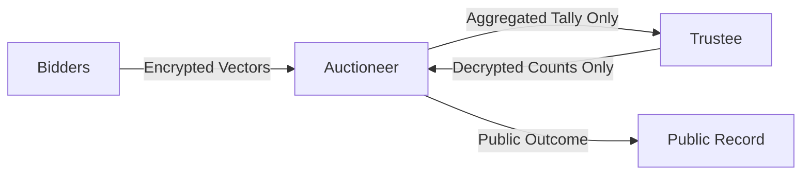

# Week 3: Security Analysis & Threat Boundaries

## Cryptographic Guarantees & Assumptions

### Core Security Assumptions:
1. **Honest-but-Curious Non-Colluding Roles**:
   The Auctioneer and the Trustee must not collude. If the Auctioneer shares individual bidder ciphertexts with the Trustee, the Trustee could decrypt individual bids. Separation of concerns prevents this.
2. **Decisional Composite Residuosity Assumption (DCRA)**:
   Under DCRA, distinguishing $n$-th residues modulo $n^2$ is computationally infeasible, guaranteeing IND-CPA security for all individual bids.

---

## Malicious Bidder Attacks & Zero-Knowledge (ZK) Proof Need

### The Arbitrary Vector Injection Attack:
In this educational implementation without Zero-Knowledge Proofs:
- An honest bidder submits a valid binary vector, e.g. $[1, 1, 1, 0, 0]$.
- A malicious bidder could craft an invalid vector containing arbitrary integers, such as $[-10, 0, 0, 100, 0]$ or $[10^6, 10^6, \dots]$.
- Because the Auctioneer blindly tallies $\prod C_i \pmod{n^2}$, the decrypted aggregate would be skewed, disrupting winner determination.

> [!IMPORTANT]
> In production multi-party computation, each bidder must attach a **non-interactive zero-knowledge (NIZK) proof** (e.g. CDS94 or Bulletproofs) proving that:
> 1. Each ciphertext $c_j$ encrypts either $0$ or $1$.
> 2. The vector is monotonically non-increasing ($v_j \ge v_{j+1}$).

---

## Information Leakage Analysis

| Participant | What They See | What Remains Confidential |
| :--- | :--- | :--- |
| **Untrusted Auctioneer** | Encrypted vectors $E(v_{i, j})$, total bidder count $N$, decrypted aggregate counts $[T_0, \dots, T_{K-1}]$ | Exact bid amount of losing bidders; individual bids. |
| **Trustee** | Aggregated vector $[C_0, \dots, C_{K-1}]$ and total bidder count $N$ | Identity of bidders; individual ciphertexts; auction registry. |
| **Losing Bidders** | Final clearing price and whether they won | Other participants' bids; winning bid margin. |
| **Public Observer** | Clearing price and winner ID | All losing bids; demand at other price levels. |

---

## Limitations of Pure Python Implementation
1. **Timing Side-Channels**: Python's `pow(base, exp, mod)` and large integer allocations are not constant-time.
2. **Key Size & Performance**: 2048-bit Paillier operations in pure Python require ~10-20ms per exponentiation.
